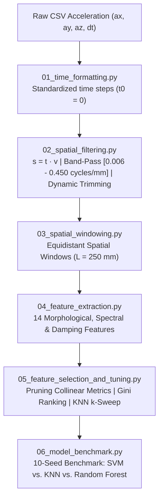
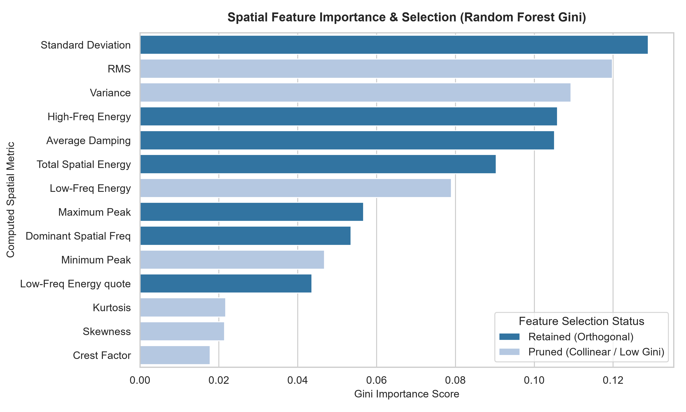
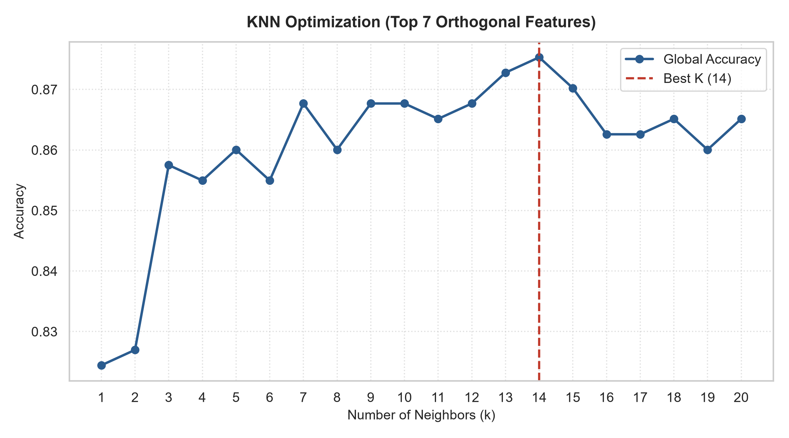
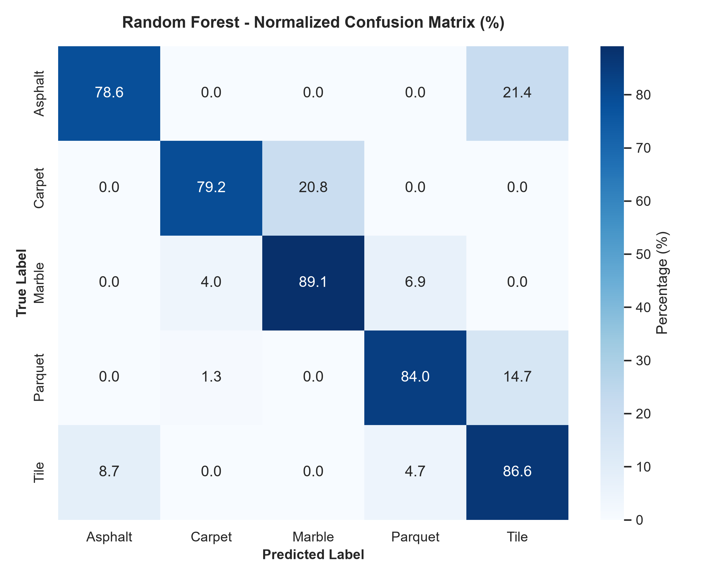
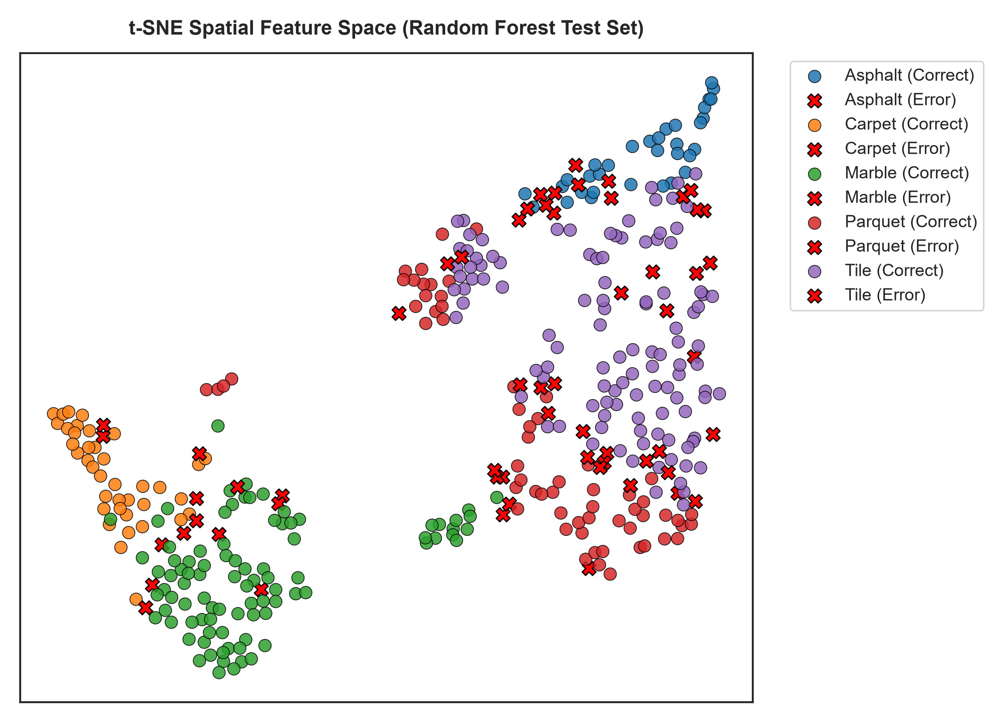

# Tactile Surface Classification via Spatial Vibration Metrology & Machine Learning

An end-to-end tactile sensing and vibration metrology pipeline for classifying commercial flooring surfaces (`Asphalt`, `Carpet`, `Marble`, `Parquet`, `Tile`) using a low-cost triaxial MEMS accelerometer (MPU-6050) dragged across test samples at controlled kinematic velocities.

---

## Overview & Metrological Rationale

Standard time-series classification of surface textures is prone to severe velocity-induced distortion: dragging an accelerometer across identical spatial asperities at varying linear speeds shifts temporal frequency peaks ($\lambda = v / f$).

To make classification strictly speed-independent, this framework introduces:

1. **Kinematic Spatial Transformation**: Continuous resampling of temporal signals into displacement coordinates ($s = t \cdot v$).
2. **Spatial Band-Pass Filtering**: Butterworth filtering ($0.006 - 0.450\text{ cycles/mm}$) isolating spatial micro-textures ($\lambda \approx 2.22\text{ mm}$ to $166.7\text{ mm}$) while rejecting DC drift and chassis macro-vibrations.
3. **Constant Geometric Windowing**: Segmentation into fixed $250\text{ mm}$ physical observation windows.
4. **Theory-Driven Feature Pruning**: Formal elimination of collinear metrics for zero-mean processes ($\text{RMS} \equiv \sigma \equiv \sqrt{\text{Var}}$), reducing the feature space to 7 orthogonal spatial descriptors.

---

## Experimental Setup & Hardware

* **Tactile Sensing Probe**: Triaxial MEMS accelerometer (MPU-6050, $\pm 2g$, 16-bit ADC) rigidly coupled to an elastic cantilever stylus.
* **Microcontroller**: ESP8266 reading over I2C at a nominal sampling rate of $f_s \approx 100\text{ Hz}$.
* **Test Surfaces & Forward Velocities**:
* **Asphalt / Stone**: $0.20768\text{ m/s}$
* **Carpet**: $0.24919\text{ m/s}$
* **Marble / Smooth Glass**: $0.48013\text{ m/s}$
* **Parquet / Wood**: $0.32362\text{ m/s}$
* **Ceramic Tile**: $0.39200\text{ m/s}$


---

## Signal Processing Pipeline



---

## Feature Engineering & Theory-Driven Pruning

From each $250\text{ mm}$ window, 14 spatial metrics were initially extracted:

* **Amplitude & Shape**: RMS, Standard Deviation ($\sigma$), Variance ($\sigma^2$), Maximum Peak, Minimum Peak, Crest Factor, Skewness, Kurtosis.
* **Fourier Spatial Spectrum**: Dominant Spatial Frequency, Total Spatial Energy, High-Frequency Energy ($>0.3\text{ cycles/mm}$), Low-Frequency Energy, Low-Frequency Energy Ratio.
* **Structural Dynamic Damping**: Average Equivalent Damping Ratio ($\zeta$) estimated around the top-3 spectral peaks via the half-power bandwidth method ($-3\text{ dB}$).

### Pruning Collinearity & Low Information

Because the spatial bandpass filter removes the DC component ($\mu \approx 0$), the mathematical identity $\text{RMS} = \sigma = \sqrt{\text{Var}}$ holds exactly. Keeping all three metrics distorts distance-based models (KNN, SVM) by redundantly inflating variance-related dimensions.

Through physical justification combined with **Random Forest Gini Importance**, the feature space was pruned to **7 orthogonal descriptors**:

1. **Standard Deviation ($\sigma$)** (retained over RMS and Variance)
2. **Total Spatial Energy**
3. **High-Frequency Spatial Energy** ($>0.3\text{ cycles/mm}$)
4. **Average Damping Ratio ($\zeta$)**
5. **Maximum Absolute Peak**
6. **Dominant Spatial Frequency**
7. **Low-Frequency Energy Ratio**

---

<p align="center">
  
</p>

## Model Benchmark & Experimental Validation

Hyperparameter tuning on K-Nearest Neighbors was conducted over $k \in [1, 20]$ across 5-fold stratified cross-validation on the 7 selected features:

<p align="center">
  
</p>

### Classification Benchmark

Evaluation across 10 independent stratified test splits ($70\%$ train, $30\%$ test):

| Model | Average Accuracy | Std Deviation | Min - Max Interval |
| --- | --- | --- | --- |
| **Random Forest (100 Trees)** | **84.8%** | $\pm 1.8\%$ | $[82.1\% - 87.4\%]$ |
| **K-Nearest Neighbors ($k=4$)** | **83.9%** | $\pm 1.6\%$ | $[81.5\% - 86.8\%]$ |
| **Support Vector Machine (RBF Kernel)** | **82.7%** | $\pm 1.9\%$ | $[79.8\% - 85.3\%]$ |

### Confusion Matrix & Error Analysis


* **Marble ($89.1\%$)**: Displays outstanding separability due to minimal high-frequency excitation and negligible damping.
* **Ceramic Tile ($86.6\%$)**: Distinct periodic impacts corresponding to grout line transitions.
* **Parquet ($84.0\%$)**: Slight leakage into Tile ($14.7\%$) caused by recurring wood plank seams mimicking tile grout joints.
* **Carpet ($79.2\%$)**: Confused primarily with Marble ($20.8\%$) due to heavy pile fiber damping attenuating higher-frequency acceleration bands.
* **Asphalt ($78.6\%$)**: Exhibits localized macro-roughness variations occasionally overlapping with coarse tile surfaces ($21.4\%$).

<p align="center">
  
</p>

### Feature Space Topology (t-SNE)

---

<p align="center">
  
</p>

## Repository Structure

```text
surface-roughness-classification/
├── data/
│   ├── raw/                      # Sample raw CSV runs for testing pipeline
│   ├── interim/                  # Intermediate data (excluded via .gitignore)
│   └── processed/
│       └── features_dataset.csv  # Verified 5-class feature dataset
├── docs/
│   └── assets/                   # High-resolution benchmark figures
├── src/
│   ├── 01_time_formatting.py
│   ├── 02_spatial_filtering.py
│   ├── 03_spatial_windowing.py
│   ├── 04_feature_extraction.py
│   ├── 05_feature_selection_and_tuning.py
│   └── 06_model_benchmark.py
├── .gitignore
├── requirements.txt
└── README.md

```

---

## Quickstart

### 1. Clone & Set Up Environment

```bash
git clone https://github.com/<your-username>/tactile-floor-recognition-ml.git
cd tactile-floor-recognition-ml

python -m venv .venv
# On Windows:
.venv\Scripts\Activate.ps1
# On Linux/macOS:
source .venv/bin/activate

pip install -r requirements.txt

```

### 2. Run Preprocessing Pipeline

To test spatial filtering and windowing on the raw sample files:

```bash
python src/01_time_formatting.py
python src/02_spatial_filtering.py
python src/03_spatial_windowing.py
python src/04_feature_extraction.py

```

### 3. Run Modeling & Benchmark

To replicate the feature importance analysis, KNN hyperparameter sweep, and multi-seed benchmarking:

```bash
python src/05_feature_selection_and_tuning.py
python src/06_model_benchmark.py

```


---
## Academic Context & Credits

This project was developed as part of the **Measurements for Mechanical Engineering** course in the Master of Science in Mechanical Engineering at **Politecnico di Milano**.

### Team Members & Contributions

The project was carried out as a team effort where all members participated in the general workflow, while focusing primarily on specific areas:
- **Riccardo Abruzzese** – *Software architecture, spatial pipeline refactoring, machine learning implementation and benchmarking & repository maintenance*.
- **Riccardo Bettinelli** – *Experimental data collection, signal pre-processing & feature extraction*.
- **Luca Ricciardi** – *Hardware setup & sensor integration*.
- **Sara Penna**, **Riccardo Mocchetto**, **Alessandro Dell'Orto** – *Exploration and development of alternative machine learning models (not included in this repository)*.

---

## License

This project is open-source under the [MIT License](https://opensource.org/licenses/MIT).